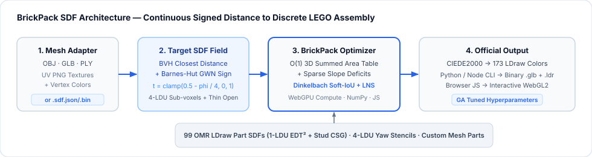
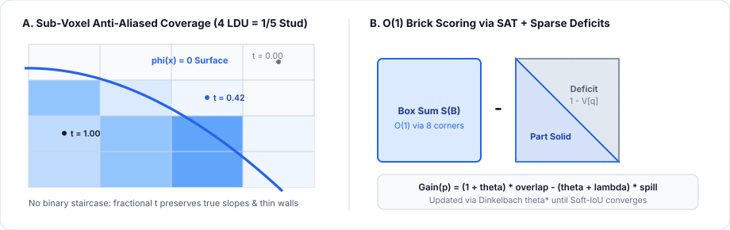
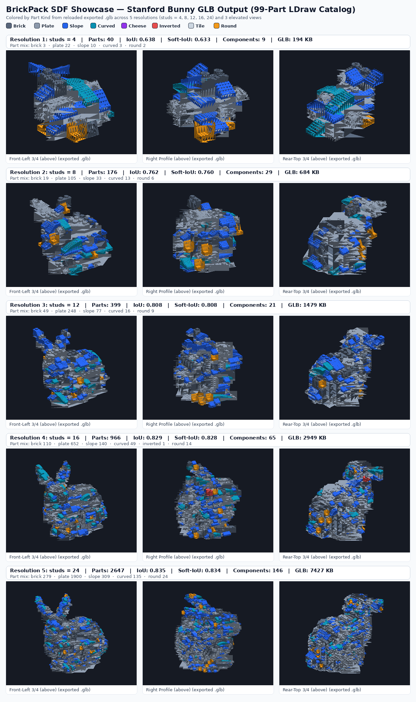

# BrickPack SDF

**Continuous Signed Distance Fields to Physically Connected LEGO Assemblies.**

BrickPack treats 3D brickification as continuous set-packing over a fractional implicit field rather than binary voxelization:

1. **Exact Target Coverage Field**: Queries each mesh (`.obj`, `.glb`, `.ply`) or pre-encoded `.sdf.json`/`.sdf.bin` grid using BVH closest distance and Barnes–Hut Generalized Winding Numbers to produce box-filtered sub-voxel occupancy $t \in [0, 1]$ on a $4\text{ LDU}$ grid ($5 \times 5 \times 2$ sub-voxels per LEGO stud-plate cell).
2. **Continuous Part Dictionary**: Represents the top 99 OMR LDraw bricks, plates, slopes, curved slopes, cheese slopes, inverted slopes, and round parts (`dataset/catalog_99.json` bundled out of the box; raw `.dat` sources fetched via `dataset/download_ldraw.py`) as exact $1\text{ LDU}$ $\mathrm{EDT}^2$ SDFs (with analytic stud CSG) and precomputed $4\text{ LDU}$ yaw stencils + sparse slope deficits.
3. **Dinkelbach Soft-IoU + LNS**: Maximizes true continuous Soft-IoU in $O(1)$ per candidate via 3D Summed Area Tables, Gaussian scale octaves, Large Neighborhood Search, and CIE DE2000 perceptual mapping to official LDraw colors (`dataset/colors.json`).



---

## Core Concept: Anti-Aliased SDF Coverage & Sparse Deficits



---

## Visual Results (Stanford Bunny GLB + 99-Part Catalog)



---

## Implementations

Both implementations share full algorithmic parity and read/write identical `.sdf.json`/`.sdf.bin`, catalog JSON, `colors.json`, `.glb`, and `.ldr` formats:

| Package | Runtime & Compute | Inference & Training Capabilities | Link |
| :--- | :--- | :--- | :--- |
| **Python** | NumPy, SciPy, Pillow (+ optional PyTorch SIREN) | Catalog trainer (`train_catalog.py`), SDF encoder (`encode_sdf.py`), BrickPack $\rightarrow$ GLB/LDR (`pack_bricks.py`), GA policy tuner (`train_policy.py`) | [`python/README.md`](python/README.md) |
| **JavaScript / Node / WebGPU** | Zero-dependency ES modules, WebGPU Compute, WebGL2 | Browser interactive WebGPU + WebGL2 studio (`js/web/`), Node CLIs (`train_catalog.mjs`, `encode_sdf.mjs`, `pack_bricks.mjs`, `train_policy.mjs`) | [`js/README.md`](js/README.md) |

---

## Downloading the Raw LDraw Library & Re-Training the Catalog

The trained 99-part catalog (`dataset/catalog_99.json`), minimal 15-part reference (`dataset/catalog_minimal.json`), and **Stanford Bunny** across `.obj`, `.glb`, and `.ply` (`dataset/models/stanford_bunny.*`) are bundled so tests, CLI scripts, and the WebGL/WebGPU studio run immediately without downloading LDraw sources. To fetch all 99 raw LDraw `.dat` parts + dependencies and re-train `catalog_99.json`:

```bash
# 1. Download the top-99 LDraw parts & LDConfig.ldr into dataset/ldraw/
python3 dataset/download_ldraw.py    # or: bash dataset/download_ldraw.sh

# 2. Encode dataset/catalog_99.json in Python or Node.js
python3 python/scripts/train_catalog.py --ldraw dataset/ldraw --rank dataset/omr_top99.json --out dataset/catalog_99.json
# or
node js/cli/train_catalog.mjs --ldraw dataset/ldraw --rank dataset/omr_top99.json --out dataset/catalog_99.json
```

---

## Repository Layout

- [`python/`](python/README.md) — Python package `brickpack_sdf`, CLI scripts, and unit tests.
- [`js/`](js/README.md) — JavaScript library (`WebGPU` + `WebGL2` + `CPU`), Node CLIs, and Browser Studio.
- [`dataset/`](dataset/ATTRIBUTION.md) — Bundled 99-part `catalog_99.json`, 15-part `catalog_minimal.json`, official LDraw palette `colors.json`, OMR top-99 index (`omr_top99.json`), `download_ldraw.{py,sh}`, and `models/stanford_bunny.{obj,glb,ply}`.
- [`docs/`](docs/README.md) — Full Table of Contents, focused algorithm paper (`BRICKPACK-short.pdf`), complete research monographs (`BRICKATOR3000-merged.pdf`, `BRICKATOR3000-light.pdf`), and references.

## Documentation & Papers

- **Algorithm Short Paper (4 pages)**: [`docs/BRICKPACK-short.pdf`](docs/BRICKPACK-short.pdf)
- **Full Research Monograph**: [`docs/BRICKATOR3000-merged.pdf`](docs/BRICKATOR3000-merged.pdf) | [`docs/BRICKATOR3000-light.pdf`](docs/BRICKATOR3000-light.pdf)
- **Docs Index & References**: [`docs/README.md`](docs/README.md)

## License & Attribution

Source code is released under the [MIT License](LICENSE). LDraw part geometry and the Stanford Bunny sample mesh are credited in [`dataset/ATTRIBUTION.md`](dataset/ATTRIBUTION.md).
