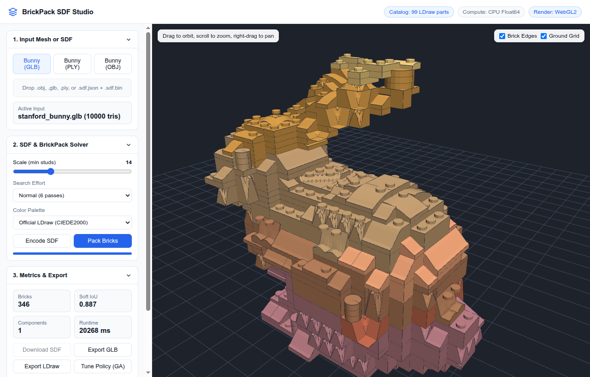

# BrickPack SDF — JavaScript, Node.js & WebGPU / WebGL2

Zero-dependency ES module implementation of BrickPack SDF running natively in **Node.js v20+** (CLI scripts & binary `.glb`/`.ldr` export) and **modern Browsers** (**WebGPU compute** SDF/deficit evaluation + **WebGL2** interactive 3D viewport).



## Quick Start

```bash
cd js
node --test test/test_brickpack.mjs
```

## Interactive Browser Studio (WebGPU + WebGL2)

```bash
cd js
npm run serve
# Open http://127.0.0.1:4173/
```

Features in `js/web/`:
- Loads **Stanford Bunny** (`.glb`, `.ply`, `.obj`) and the 99-part `catalog_99.json` out of the box, or drag & drop any `.obj`, `.glb`, `.ply`, or `.sdf.json` + `.sdf.bin`.
- Automatic **WebGPU** acceleration for BVH closest-distance/GWN and dense deficit scoring (seamless Float64 CPU fallback when `navigator.gpu` is unavailable).
- Real-time interactive **WebGL2** brick renderer with orbit/zoom/pan controls, brick edge wireframes, and one-click `.glb`, `.ldr`, and `.sdf.json/.bin` downloads.
- Built-in live Genetic Algorithm policy tuning right in the browser.

## Node.js CLI Workflows

### 1. Download LDraw & Train a Part Catalog (or Custom Mesh Collection)

`dataset/catalog_99.json` (the pre-trained 99-part top-OMR LDraw catalog) is bundled as the default for Node CLIs and the Browser Studio. To re-download raw LDraw `.dat` parts on demand and rebuild or customize the catalog:

```bash
# Download official LDraw .dat parts into ../dataset/ldraw (not committed to git)
npm run download:ldraw   # or: python3 ../dataset/download_ldraw.py

# Encode the 99-part BrickPack SDF catalog in Node.js
node cli/train_catalog.mjs \
  --ldraw ../dataset/ldraw \
  --rank ../dataset/omr_top99.json \
  --out ../dataset/catalog_99.json

# Or train custom parts directly from a folder of .obj/.glb/.ply meshes:
node cli/train_catalog.mjs --models ./my_part_meshes --out ./out/custom_catalog.json
```

### 2. Encode an SDF Volume (`.sdf.json` + `.sdf.bin`)

```bash
node cli/encode_sdf.mjs ../dataset/models/stanford_bunny.obj --res 64 --out ./out/bunny.sdf.json
```

### 3. Convert Mesh or `.sdf.json` to LEGO Bricks (`.glb` + `.ldr`)

```bash
# Uses catalog_99.json by default:
node cli/pack_bricks.mjs ../dataset/models/stanford_bunny.glb --studs 16 --out ./out/bunny_bricks.glb --ldr ./out/bunny_bricks.ldr

# Or pass the lightweight 15-part minimal catalog:
node cli/pack_bricks.mjs ./out/bunny.sdf.json --catalog ../dataset/catalog_minimal.json --studs 16 --out ./out/bunny_min.glb
```

### 4. Train BrickPack Hyperparameters via GA

```bash
node cli/train_policy.mjs --models ../dataset/models --catalog ../dataset/catalog_99.json --studs 10 --pop 6 --gens 3 --out ./out/policy.json
```

## Programmatic ES Module Example

```js
import fs from 'node:fs';
import { loadModelFile, buildBricksMesh, exportGLB } from './src/mesh_io.js';
import { deserializeCatalog } from './src/dictionary.js';
import { packModelAsync } from './src/engine.js';

const catalog = deserializeCatalog(fs.readFileSync('../dataset/catalog_99.json', 'utf8'));
const colors  = JSON.parse(fs.readFileSync('../dataset/colors.json', 'utf8')).colors;
const model   = await loadModelFile('../dataset/models/stanford_bunny.ply');

const res = await packModelAsync(model, { studs: 14, effort: 'normal', catalog, colors });
console.log(`Bricks: ${res.pack.pieces} | Soft-IoU: ${res.pack.softIoU}`);

const mesh = buildBricksMesh(res.pieces, catalog);
fs.writeFileSync('./out/bunny_bricks.glb', exportGLB(mesh));
```
