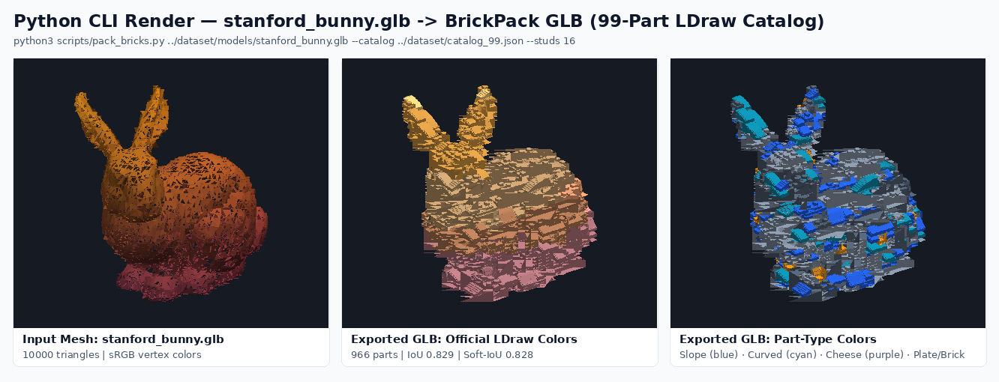

# BrickPack SDF — Python Implementation

Pure Python implementation powered by NumPy, SciPy (`distance_transform_edt`, `gaussian_filter`), and Pillow — with optional PyTorch neural SDF (`--method siren`) encoding on CPU or CUDA.



## Quick Start

```bash
cd python
pip install -r requirements.txt
# Optional for neural SIREN SDF fitting:
# pip install torch

python3 -m unittest discover -s tests -v
```

## CLI Workflows

### 1. Download LDraw & Train a Part Catalog (or Custom Mesh Collection)

`dataset/catalog_99.json` (the pre-trained 99-part top-OMR LDraw catalog) is bundled as the default for all Python scripts. To re-download raw LDraw `.dat` parts on demand and rebuild or customize the catalog:

```bash
# Download official LDraw .dat parts into ../dataset/ldraw (not committed to git)
python3 ../dataset/download_ldraw.py

# Encode the 99-part BrickPack SDF catalog
python3 scripts/train_catalog.py \
  --ldraw ../dataset/ldraw \
  --rank ../dataset/omr_top99.json \
  --out ../dataset/catalog_99.json

# Or train custom brick primitives from a folder of .obj/.glb/.ply meshes
python3 scripts/train_catalog.py --models ./my_part_meshes --out ./out/my_parts.json
```

### 2. Encode a Mesh into a Continuous SDF (`.sdf.json` + `.sdf.bin`)

```bash
# Exact Barnes-Hut GWN + BVH closest point
python3 scripts/encode_sdf.py ../dataset/models/stanford_bunny.obj --res 64 -o ./out/bunny.sdf.json

# Or neural implicit SIREN fit (requires PyTorch)
python3 scripts/encode_sdf.py ../dataset/models/stanford_bunny.glb --res 64 --method siren -o ./out/bunny_siren.sdf.json
```

### 3. Convert Mesh or Encoded SDF to LEGO Bricks (`.glb` + `.ldr`)

```bash
# Directly from GLB / PLY / OBJ -> binary GLB + LDraw (uses catalog_99.json by default)
python3 scripts/pack_bricks.py ../dataset/models/stanford_bunny.glb --studs 16 -o ./out/bunny_bricks.glb --ldr ./out/bunny_bricks.ldr

# Or from an encoded .sdf.json file (use --catalog ../dataset/catalog_minimal.json for quick 15-part packing):
python3 scripts/pack_bricks.py ./out/bunny.sdf.json --studs 16 --effort thorough -o ./out/bunny_99.glb
```

### 4. Train Policy Hyperparameters with the Genetic Algorithm

```bash
python3 scripts/train_policy.py \
  --models ../dataset/models \
  --catalog ../dataset/catalog_99.json \
  --studs 10 --pop 6 --gens 3 -o ./out/policy.json
```

## Python Library Usage

```python
from brickpack_sdf import (
    load_model, load_catalog, load_colors,
    encode_sdf_volume, pack_model, build_bricks_mesh, export_glb
)

catalog = load_catalog("../dataset/catalog_99.json")
colors  = load_colors("../dataset/colors.json")
model   = load_model("../dataset/models/stanford_bunny.ply")

# Encode continuous SDF grid
hdr, sdf_grid = encode_sdf_volume(model, res=48)

# Solve Dinkelbach Soft-IoU packing (accepts mesh dict OR (hdr, sdf_grid))
result = pack_model((hdr, sdf_grid), catalog=catalog, studs=14, colors=colors)
print(f"Placed {result['pack']['pieces']} bricks | Soft-IoU={result['pack']['softIoU']}")

# Synthesize colored brick+stud triangle mesh and save binary GLB
mesh = build_bricks_mesh(result["pieces"], catalog)
export_glb(mesh, "./out/bunny_bricks.glb")
```
